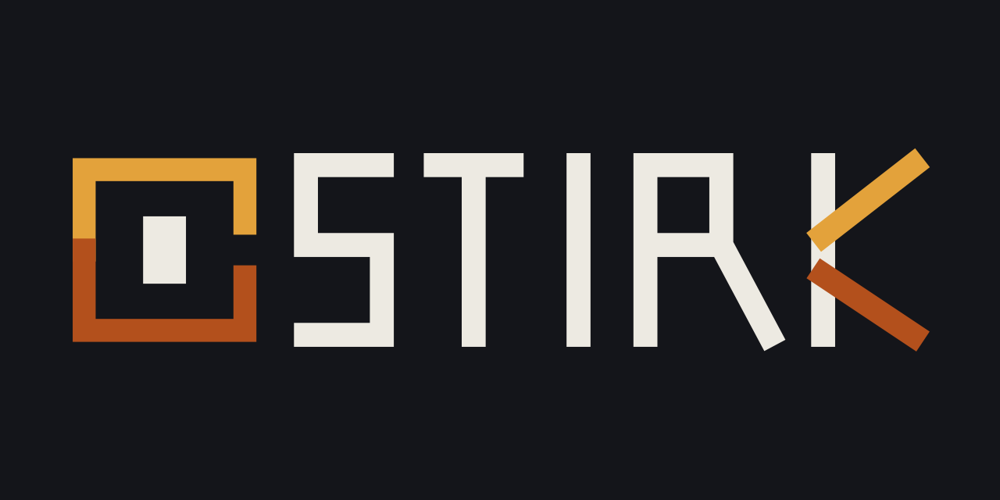

<p align="center">
  
</p>

<h1 align="center">Stirk AI Website</h1>

<p align="center"><em>AI agents created and written with Kirn.</em></p>

<p align="center">
  
  
  
  
</p>

<p align="center">
  <a href="https://stirk-ai.github.io/">Website</a> ·
  <a href="https://github.com/stirk-ai/stirk-ai">Stirk source</a> ·
  <a href="https://kirn-lang.github.io/">Kirn</a>
</p>

## Overview

Stirk AI is an early-stage project for creating AI agents with the Kirn programming language. It explores agents that can understand a goal, plan useful steps, use tools with boundaries, and leave behind an inspectable trail of work.

This repository contains the public Stirk AI website: a responsive landing page, agent-console visual, SEO metadata, theme controls, ecosystem links, crawler files, and custom 404 page.

## Website features

- Agent-orchestration visual language with responsive layouts.
- System, light, and dark theme modes with saved preference.
- Animated typewriter messaging in the hero section.
- Search-friendly metadata, Open Graph previews, Twitter cards, and JSON-LD.
- Links to Kirn, Kirnly, Pats, Kirsh, KirnOS, Kirn documentation, and the creator.
- Accessibility, contribution, security, conduct, ownership, and license documentation.

## Related projects

- [Stirk AI source](https://github.com/stirk-ai/stirk-ai)
- [Kirn programming language](https://kirn-lang.github.io/)
- [Kirn documentation](https://rkriad585.github.io/kirn/)
- [Kirnly editor](https://kirnly.github.io/)
- [Pats registry](https://pats-registry.github.io/)
- [Pats contribution guide](https://pats-registry.github.io/pats/)
- [Kirsh terminal](https://kirsh-shell.github.io/)
- [KirnOS](https://kirnos-kernel.github.io/)
- [Creator — RK Riad Khan](https://rkriad585.github.io/)

## Local preview

This is a dependency-free static website. Serve the repository with any static HTTP server, for example:

```bash
python3 -m http.server 8080
```

Then open <http://localhost:8080>.

## License

The website content and source are released under the MIT License.
